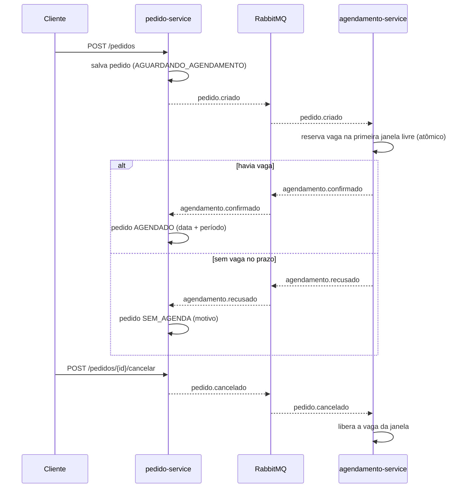

# Pedidos + Agendamento de Entrega

Dois microsserviços **Spring Boot 3.5 / Java 21** que se comunicam por **eventos no RabbitMQ**:

- **pedido-service**: recebe pedidos com uma data de entrega desejada e acompanha o resultado do agendamento.
- **agendamento-service**: mantém janelas de entrega com capacidade (por UF, data e período) e reserva uma vaga para cada pedido.

Cada serviço tem o próprio banco no **MongoDB** (database per service). Nenhum serviço consulta o banco do outro: a única integração é por eventos.

## Arquitetura



### Topologia no RabbitMQ

| Exchange (topic) | Routing key | Fila | Consumidor |
|---|---|---|---|
| `pedidos.events` | `pedido.criado` | `agendamento-service.pedido-criado` | agendamento-service |
| `pedidos.events` | `pedido.cancelado` | `agendamento-service.pedido-cancelado` | agendamento-service |
| `agendamentos.events` | `agendamento.confirmado` | `pedido-service.agendamento-confirmado` | pedido-service |
| `agendamentos.events` | `agendamento.recusado` | `pedido-service.agendamento-recusado` | pedido-service |

Cada fila tem uma **DLQ** (`<fila>.dlq`) ligada a um dead-letter exchange do serviço.

## Decisões técnicas

- **Reserva atômica de capacidade.** A vaga é reservada com um único `findAndModify` que só incrementa `ocupados` quando `ocupados < capacidade` (`$expr`). Dois pedidos concorrentes nunca estouram a janela, sem lock pessimista e sem transação distribuída.
- **Consumidor idempotente.** O agendamento usa o **id do pedido como `_id`**. O primeiro passo é inserir o registro `PROCESSANDO`: se o evento chegar duplicado, o insert falha com `DuplicateKeyException` e o serviço só reenvia o resultado que já existe. Do lado do pedido, a transição de estado só acontece a partir de `AGUARDANDO_AGENDAMENTO`, então eventos repetidos são ignorados.
- **Cancelamento fora de ordem.** Se o `pedido.cancelado` chegar antes do `pedido.criado`, o agendamento grava um registro `CANCELADO` e o evento de criação, quando chegar, não reserva vaga.
- **Retentativa + DLQ.** Os listeners tentam 3 vezes com backoff exponencial (1s, 2s). Depois disso, a mensagem é rejeitada sem requeue e vai para a DLQ, sem travar a fila nem se perder.
- **Concorrência otimista.** Os documentos têm `@Version`. Uma atualização concorrente gera `OptimisticLockingFailureException`, que vira HTTP 409 na API ou nova tentativa no listener.
- **Contratos de evento explícitos.** Os eventos são `record`s com `eventoId` e `ocorridoEm`. Cada serviço tem a sua cópia do contrato, de propósito, para não haver acoplamento por biblioteca compartilhada. O conversor JSON usa o tipo do parâmetro do listener, sem depender do nome da classe de quem publicou.
- **Erros padronizados.** As respostas de erro seguem a RFC 9457 (`ProblemDetail`), com detalhe por campo nas validações.
- **Sem DDL.** Nenhum serviço cria schema ou índice (`auto-index-creation: false`). As collections nascem na primeira gravação, e a unicidade necessária vem do `_id`.

### Limitações conhecidas (próximos passos)

- **Dual write.** O pedido é salvo e depois o evento é publicado. Se o serviço cair entre os dois passos, o evento se perde. A evolução natural é um **Transactional Outbox** (collection de outbox + publicador).
- **Reserva órfã.** Se o agendamento cair depois de reservar a vaga e antes de gravar `CONFIRMADO`, a vaga fica presa. Isso pede uma rotina de reconciliação ou uma saga com compensação.
- **Testes de integração** com Testcontainers (MongoDB e RabbitMQ) para o fluxo ponta a ponta.

## Como rodar

Pré-requisitos: Docker e JDK 21.

```bash
# 1. Infra (MongoDB + RabbitMQ)
docker compose up -d

# 2. Build
mvn -DskipTests package

# 3. Serviços (em dois terminais)
java -jar pedido-service/target/pedido-service-1.0.0-SNAPSHOT.jar
java -jar agendamento-service/target/agendamento-service-1.0.0-SNAPSHOT.jar

# Ou tudo em container, depois do build:
docker compose --profile app up -d --build
```

| Serviço | URL | Swagger |
|---|---|---|
| pedido-service | http://localhost:8081 | http://localhost:8081/swagger-ui.html |
| agendamento-service | http://localhost:8082 | http://localhost:8082/swagger-ui.html |
| RabbitMQ (painel) | http://localhost:15672 (guest/guest) | |

## Exemplo de uso

```bash
# Cadastrar capacidade de entrega
curl -s -X POST localhost:8082/janelas -H 'Content-Type: application/json' \
  -d '{"uf":"SP","data":"2026-12-10","periodo":"MANHA","capacidade":2}'

# Criar um pedido
curl -s -X POST localhost:8081/pedidos -H 'Content-Type: application/json' -d '{
  "cliente": "Loja Exemplo",
  "endereco": {"logradouro":"Av. Paulista","numero":"1000","cidade":"São Paulo","uf":"SP","cep":"01310100"},
  "itens": [{"sku":"CAFE-500G","descricao":"Café 500g","quantidade":10}],
  "dataEntregaDesejada": "2026-12-10"
}'

# Acompanhar (status AGUARDANDO_AGENDAMENTO -> AGENDADO ou SEM_AGENDA)
curl -s localhost:8081/pedidos/<id>
curl -s localhost:8082/agendamentos/<id>
curl -s 'localhost:8082/janelas?uf=SP&de=2026-12-10&ate=2026-12-17'

# Cancelar (libera a vaga)
curl -s -X POST localhost:8081/pedidos/<id>/cancelar -H 'Content-Type: application/json' \
  -d '{"motivo":"Cliente desistiu"}'
```

Regras do agendamento:
- procura vaga da data desejada (ou de hoje, se ela já passou) até a data desejada + `agendamento.dias-busca` (padrão 7);
- só considera janelas da UF do endereço;
- a ordem é por data e período (manhã antes da tarde).

## Stack

Java 21 · Spring Boot 3.5 (Web, Validation, Data MongoDB, AMQP, Actuator) · RabbitMQ 3.13 · MongoDB 7 · springdoc-openapi · Docker Compose
