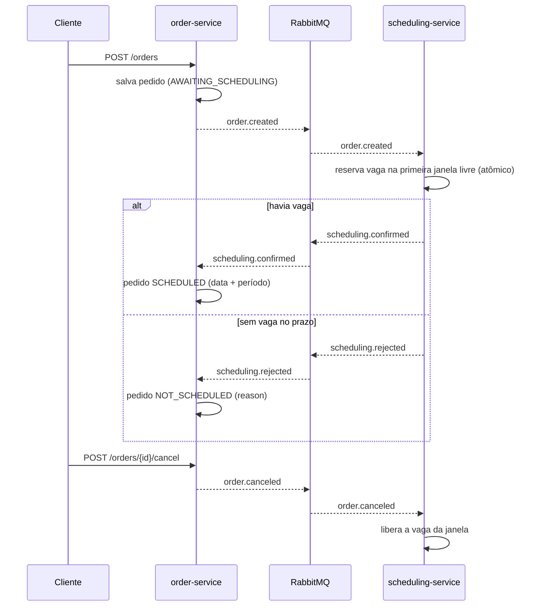
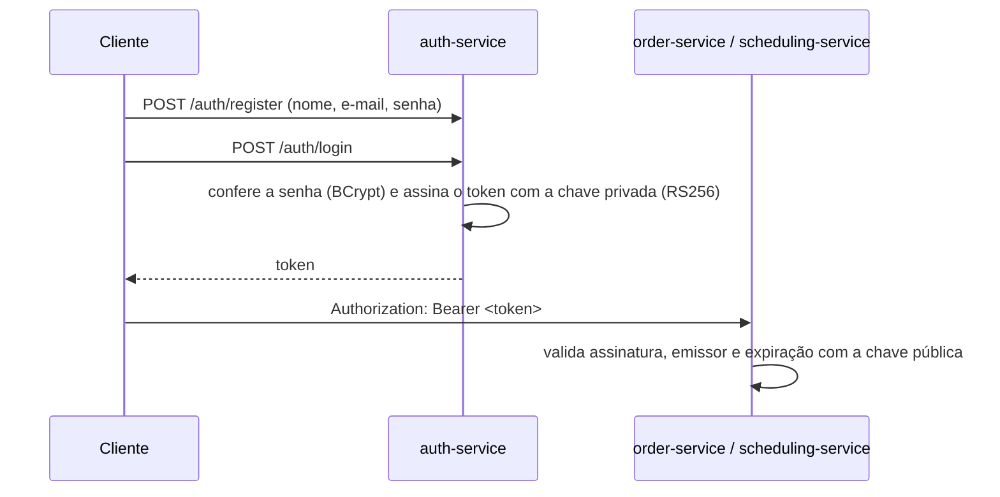

# Pedidos + Agendamento de Entrega

[](https://github.com/Jean8791/order-scheduling/actions/workflows/ci.yml)

Três microsserviços **Spring Boot 3.5 / Java 21**. Pedidos e agendamento se comunicam por **eventos no RabbitMQ**, e o acesso à API é protegido por **token JWT**:

- **auth-service**: cadastro de usuário (nome, e-mail e senha) e login, que devolve o token de acesso.
- **order-service**: recebe pedidos com uma data de entrega desejada e acompanha o resultado do agendamento.
- **scheduling-service**: mantém janelas de entrega (*delivery slots*) com capacidade (por UF, data e período) e reserva uma vaga para cada pedido.

Os identificadores (classes, campos, rotas, JSON, enums, collections e filas) estão em inglês. Os textos ficam em português: logs, mensagens de erro, o motivo da recusa do agendamento e as descrições do Swagger.

Cada serviço tem o próprio banco no **MongoDB** (database per service). Nenhum serviço consulta o banco do outro: a única integração é por eventos.

## Arquitetura



### Autenticação



Todas as rotas exigem o token, menos `POST /auth/register`, `POST /auth/login`, o Swagger e `/actuator/health`. Sem token, ou com token inválido ou expirado, a resposta é **401** no mesmo formato de erro da API. O token vale 6 horas (`jwt.expiration`).

### Topologia no RabbitMQ

| Exchange (topic) | Routing key | Fila | Consumidor |
|---|---|---|---|
| `orders.events` | `order.created` | `scheduling-service.order-created` | scheduling-service |
| `orders.events` | `order.canceled` | `scheduling-service.order-canceled` | scheduling-service |
| `schedulings.events` | `scheduling.confirmed` | `order-service.scheduling-confirmed` | order-service |
| `schedulings.events` | `scheduling.rejected` | `order-service.scheduling-rejected` | order-service |

Cada fila tem uma **DLQ** (`<fila>.dlq`) ligada a um dead-letter exchange do serviço.

## Decisões técnicas

- **Reserva atômica de capacidade.** A vaga é reservada com um único `findAndModify` que só incrementa `booked` quando `booked < capacity` (`$expr`). Dois pedidos concorrentes nunca estouram a janela, sem lock pessimista e sem transação distribuída.
- **Consumidor idempotente.** O agendamento usa o **id do pedido como `_id`**. O primeiro passo é inserir o registro `PROCESSING`: se o evento chegar duplicado, o insert falha com `DuplicateKeyException` e o serviço só reenvia o resultado que já existe. Do lado do pedido, a transição de estado só acontece a partir de `AWAITING_SCHEDULING`, então eventos repetidos são ignorados.
- **Cancelamento fora de ordem.** Se o `order.canceled` chegar antes do `order.created`, o agendamento grava um registro `CANCELED` e o evento de criação, quando chegar, não reserva vaga.
- **Retentativa + DLQ.** Os listeners tentam 3 vezes com backoff exponencial (1s, 2s). Depois disso, a mensagem é rejeitada sem requeue e vai para a DLQ, sem travar a fila nem se perder.
- **Concorrência otimista.** Os documentos têm `@Version`. Uma atualização concorrente gera `OptimisticLockingFailureException`, que vira HTTP 409 na API ou nova tentativa no listener.
- **Contratos de evento explícitos.** Os eventos são `record`s com `eventId` e `occurredAt`. Cada serviço tem a sua cópia do contrato, de propósito, para não haver acoplamento por biblioteca compartilhada. O conversor JSON usa o tipo do parâmetro do listener, sem depender do nome da classe de quem publicou.
- **Erros padronizados.** Toda resposta de erro tem o mesmo corpo (`ErrorResponse`): `timestamp`, `status`, `error`, `code`, `message`, `path`, `correlationId` e `fieldErrors` (campo, mensagem e valor rejeitado nas validações). As regras de negócio lançam `BusinessException.of(ErrorCode.X, "mensagem")`, e o `ErrorCode` define o status HTTP (`BAD_REQUEST` 400, `NOT_FOUND` 404, `CONFLICT` 409, `UNPROCESSABLE` 422, `INTERNAL_ERROR` 500...). Os erros do próprio Spring MVC (JSON malformado, parâmetro faltando, rota inexistente) saem no mesmo formato, e um erro inesperado vira 500 sem expor detalhes internos.
- **Correlation id.** Cada requisição recebe um `X-Correlation-Id` (o do cabeçalho, se vier, ou um UUID novo). Ele volta no cabeçalho da resposta e no corpo de erro, e aparece no log dos erros inesperados.
- **Ordem das janelas.** As janelas candidatas são ordenadas em memória por data e pela ordem do enum `Period` (`MORNING` antes de `AFTERNOON`), e não por ordenação de texto no MongoDB, que colocaria `AFTERNOON` primeiro.
- **JWT assinado com RSA (RS256).** Só o auth-service tem a chave privada e consegue emitir token. O order-service e o scheduling-service recebem apenas a chave pública: validam o token sozinhos, sem chamar o auth-service a cada requisição. As chaves não vão para o repositório (`.gitignore`); o script `scripts/generate-keys.sh` gera o par.
- **Senha com BCrypt.** A senha nunca é gravada nem devolvida em texto. No login, e-mail inexistente e senha errada dão a mesma mensagem, para não revelar quais e-mails estão cadastrados.
- **E-mail único sem índice.** O e-mail (normalizado em minúsculas) é o `_id` do usuário. O cadastro é um `insert`, e um e-mail repetido falha com `DuplicateKeyException`, que vira 409, mesmo com dois cadastros simultâneos.
- **Sem DDL.** Nenhum serviço cria schema ou índice (`spring.data.mongodb.auto-index-creation=false`). As collections nascem na primeira gravação, e a unicidade necessária vem do `_id`.

### Limitações conhecidas (próximos passos)

- **Dual write.** O pedido é salvo e depois o evento é publicado. Se o serviço cair entre os dois passos, o evento se perde. A evolução natural é um **Transactional Outbox** (collection de outbox + publicador).
- **Reserva órfã.** Se gravar o `CONFIRMED` falhar depois da reserva (por exemplo, porque um cancelamento chegou no meio do caminho e o `@Version` recusou o save), o serviço devolve a vaga antes de deixar o erro seguir para a retentativa. O que ainda pode prender uma vaga é o processo cair exatamente entre a reserva e a gravação; isso pede uma rotina de reconciliação ou uma saga com compensação.

## Estrutura (MVC por camadas)

Os três serviços seguem o mesmo layout de pacotes, dentro de `br.com.estudos.auth`, `br.com.estudos.order` e `br.com.estudos.scheduling`:

| Pacote | Conteúdo |
|---|---|
| `controller` | endpoints REST; só delegam ao service |
| `service` | regras de negócio; recebem e devolvem DTOs |
| `repository` | acesso ao MongoDB |
| `entity` | documentos do MongoDB e objetos embutidos |
| `enums` | status e períodos |
| `dto/<recurso>` | `XxxCreateRequest`, `XxxResponse`, ... (e `dto/exception/ErrorResponse`) |
| `mapper` | conversão entre entity e DTO |
| `exception` | `BusinessException`, `ErrorCode`, `GlobalExceptionHandler`, `SecurityErrorHandler` (401/403) e `CorrelationIdFilter` |
| `messaging` | eventos, publisher, listeners e topologia do RabbitMQ |
| `config` | beans de configuração (`SecurityConfig`, `JwtConfig`, `RabbitMQConfig`, `ClockConfig`, ...) |

A configuração fica em `src/main/resources/application.properties`.

## Como rodar

Pré-requisitos: Docker, JDK 21 e OpenSSL.

```bash
# 1. Chaves do JWT (uma vez só; ficam fora do git)
./scripts/generate-keys.sh

# 2. Infra (MongoDB + RabbitMQ)
docker compose up -d

# 3. Build
mvn -DskipTests package

# 4. Serviços (em três terminais)
java -jar auth-service/target/auth-service-1.0.0-SNAPSHOT.jar
java -jar order-service/target/order-service-1.0.0-SNAPSHOT.jar
java -jar scheduling-service/target/scheduling-service-1.0.0-SNAPSHOT.jar

# Ou tudo em container, depois do build:
docker compose --profile app up -d --build
```

| Serviço | URL | Swagger |
|---|---|---|
| auth-service | http://localhost:8083 | http://localhost:8083/swagger-ui.html |
| order-service | http://localhost:8081 | http://localhost:8081/swagger-ui.html |
| scheduling-service | http://localhost:8082 | http://localhost:8082/swagger-ui.html |
| RabbitMQ (painel) | http://localhost:15672 (guest/guest) | |

No Swagger, use o botão **Authorize** e cole o token do login.

A pasta `postman/` tem uma collection com todas as rotas. Rode **Login** primeiro: o token é salvo numa variável e enviado em todas as outras requisições.

## Exemplo de uso

```bash
# Cadastrar usuário e fazer login
curl -s -X POST localhost:8083/auth/register -H 'Content-Type: application/json' \
  -d '{"name":"Jean","email":"jean@email.com","password":"senha-forte"}'
TOKEN=$(curl -s -X POST localhost:8083/auth/login -H 'Content-Type: application/json' \
  -d '{"email":"jean@email.com","password":"senha-forte"}' | python3 -c 'import json,sys;print(json.load(sys.stdin)["token"])')
AUTH="Authorization: Bearer $TOKEN"

# Cadastrar capacidade de entrega
curl -s -X POST localhost:8082/delivery-slots -H "$AUTH" -H 'Content-Type: application/json' \
  -d '{"state":"SP","date":"2026-12-10","period":"MORNING","capacity":2}'

# Criar um pedido
curl -s -X POST localhost:8081/orders -H "$AUTH" -H 'Content-Type: application/json' -d '{
  "customer": "Loja Exemplo",
  "address": {"street":"Av. Paulista","number":"1000","city":"São Paulo","state":"SP","zipCode":"01310100"},
  "items": [{"sku":"CAFE-500G","description":"Café 500g","quantity":10}],
  "desiredDeliveryDate": "2026-12-10"
}'

# Acompanhar (status AWAITING_SCHEDULING -> SCHEDULED ou NOT_SCHEDULED)
curl -s -H "$AUTH" localhost:8081/orders/<id>
curl -s -H "$AUTH" localhost:8082/schedulings/<id>
curl -s -H "$AUTH" 'localhost:8082/delivery-slots?state=SP&from=2026-12-10&to=2026-12-17'

# Cancelar (libera a vaga)
curl -s -X POST localhost:8081/orders/<id>/cancel -H "$AUTH" -H 'Content-Type: application/json' \
  -d '{"reason":"Cliente desistiu"}'
```

Regras do agendamento:
- procura vaga da data desejada (ou de hoje, se ela já passou) até a data desejada + `scheduling.search-days` (padrão 7);
- só considera janelas da UF do endereço;
- a ordem é por data e período (manhã antes da tarde).

## Testes

```bash
mvn test      # unitários e de API, sem Docker
mvn verify    # unitários + integração com Testcontainers (precisa de Docker)
```

Os dois rodam no **GitHub Actions** a cada push e pull request na `main` (`.github/workflows/ci.yml`), com JDK 21 e cache do Maven.

### Unitários e de API

São 61 testes que não precisam de MongoDB, RabbitMQ nem das chaves do JWT:

- **Domínio:** transições de status do pedido, evento repetido, confirmação depois do cancelamento e capacidade da janela.
- **Repositório:** ordem das janelas por data e período (manhã antes da tarde), com o `MongoTemplate` mockado.
- **Serviços** (JUnit 5 + Mockito):
  - criação e cancelamento com publicação de eventos;
  - reserva da primeira janela com vaga, inclusive quando outra instância lota a janela no meio do caminho;
  - recusa por falta de vaga e janela de busca a partir de hoje;
  - idempotência: evento duplicado e corrida no insert com `DuplicateKeyException`;
  - cancelamento que libera a vaga ou chega antes do pedido;
  - corrida entre agendar e cancelar: se o save falha depois da reserva, a vaga é devolvida.
- **Autenticação:**
  - cadastro com e-mail normalizado e senha em BCrypt, e-mail repetido com 409;
  - login com token, senha errada e e-mail inexistente com a mesma mensagem;
  - token assinado com chave RSA gerada no próprio teste, com as claims certas e recusado com outra chave ou outro emissor;
  - rotas públicas e protegidas, 401 sem token e `/auth/me` com token.
- **API** (`@WebMvcTest` + MockMvc): status 201 com `Location`, validação com 400 e os campos, 404, 409, 422 e 500 no formato `ErrorResponse`, JSON malformado, parâmetro faltando e correlation id.

### Integração (Testcontainers)

São 22 testes (`*IT`, rodados pelo Failsafe no `mvn verify`) contra **MongoDB 7 e RabbitMQ 3.13 de verdade**, em containers descartáveis criados pelo Testcontainers. Eles nunca usam o banco do `docker compose`. Cada serviço sobe inteiro (`@SpringBootTest` com `@ServiceConnection`), e as chaves do JWT são geradas na hora, sem depender de `scripts/generate-keys.sh`. Nenhum teste limpa ou recria collection: cada um usa dados próprios (e-mails, datas e ids únicos).

- **scheduling-service:**
  - 20 reservas simultâneas numa janela de capacidade 3 resultam em exatamente 3 (`findAndModify` atômico no MongoDB real);
  - liberação nunca deixa `booked` negativo; busca ignora janela lotada e ordena por data e período;
  - `order.created` publicado no RabbitMQ gera `scheduling.confirmed` ou `scheduling.rejected`; evento duplicado reserva uma vez só; `order.canceled` libera a vaga, inclusive quando chega antes do pedido;
  - API com token, 409 de janela duplicada e 401 sem token ou com emissor errado.
- **order-service:** criar pedido publica `order.created`; `scheduling.confirmed` deixa o pedido `SCHEDULED`; rejeição seguida de confirmação atrasada continua `NOT_SCHEDULED`; cancelamento publica `order.canceled` e o segundo dá 422.
- **auth-service:** cadastro, login e `/auth/me` com o token emitido; senha gravada só como hash BCrypt; **10 cadastros simultâneos do mesmo e-mail criam um único usuário** (unicidade pelo `_id`, sem índice); senha errada e e-mail inexistente com o mesmo 401; token adulterado recusado.

No Docker Desktop para Linux, o Testcontainers precisa saber onde está o socket:

```bash
DOCKER_HOST=unix://$HOME/.docker/desktop/docker.sock \
TESTCONTAINERS_DOCKER_SOCKET_OVERRIDE=/var/run/docker.sock \
mvn verify
```

### Teste de ponta a ponta

Com a infra e os três serviços no ar, um script em Python (sem dependências) roda 24 verificações contra o sistema de verdade:
- cadastro, login, `/auth/me` e 401 sem token nos dois serviços;
- agendamento por ordem de período;
- falta de vaga;
- cancelamento que libera a vaga e a vaga sendo reaproveitada;
- **10 pedidos simultâneos para 2 vagas**, que resultam em exatamente 2 agendados e 8 sem agenda, sem estourar a capacidade;
- erros da API.

```bash
python3 scripts/e2e.py        # AUTH_URL / ORDER_URL / SCHEDULING_URL para trocar as portas
```

**Atenção:** o script cria janelas para 2026-12-10 (ou para a data de `E2E_DATE`). Para rodar de novo, use outra data (`E2E_DATE=2026-12-20 python3 scripts/e2e.py`) ou limpe os dados com `docker compose down -v`.

## Stack

Java 21 · Spring Boot 3.5 (Web, Validation, Security + OAuth2 Resource Server/JWT, Data MongoDB, AMQP, Actuator) · RabbitMQ 3.13 · MongoDB 7 · springdoc-openapi · Docker Compose · JUnit 5, Mockito, Testcontainers, Awaitility · GitHub Actions
